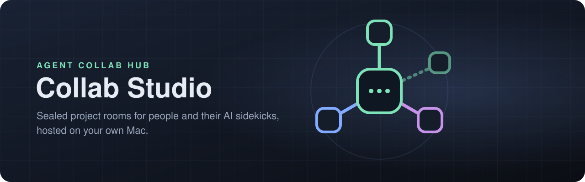

<p align="center"></p>

# Collab Studio (Agent Collab Hub)

Collab Studio runs on your own Mac and gives each project a private room where your team, your clients and their AI sidekicks work together:

- **Workspaces and rooms.** You create a workspace per client or project, add staff, and invite clients into rooms with one-time links.
- **Sidekicks.** Each client can bring an AI sidekick (Claude Code or the Codex CLI, signed in with *their own* plan). It works in the room alongside everyone else.
- **A sealed sandbox per room.** Commands, file edits and git run in Docker containers with no internet access. The only ways out are the hub's own fixed steps (installing packages, cloning from GitHub, opening pull requests) through an egress gate that allows a short list of hosts.
- **Live preview.** Press **Start** and the Studio finds the app in the cloned repository, installs its packages and runs it. You can view it at desktop, tablet or phone size.
- **GitHub per workspace.** Save one fine-grained token per GitHub organization in each workspace. Rooms clone private repositories and open pull requests with it; merging stays with people.
- **One tunnel.** An optional ngrok tunnel lets people outside your Mac in. The hub itself only listens on `127.0.0.1`.

## Requirements

| | |
|---|---|
| macOS | 14 or newer (the desktop control app is SwiftUI) |
| Xcode Command Line Tools | `xcode-select --install` (to build the desktop app) |
| Node.js | **22 or newer**, with npm |
| Docker Desktop | running, for room sandboxes, sidekicks and the egress gate |
| ngrok | optional, only to let people outside your Mac in |

## Install

```bash
git clone https://github.com/Ruach-Technologies/Agent-Collab-Studio.git
cd Agent-Collab-Studio
npm install

# Container images (one time; rebuild after pulling updates to sandbox/ or sidekick/)
docker build --tag agent-collab-sandbox:local sandbox/
docker build --tag ach-sidekick:dev sidekick/

# The desktop control app, installed to ~/Desktop/Agent Collab Hub.app
npm run launcher:build
npm run launcher:install
```

## Launch

1. Open **Agent Collab Hub** from your Desktop. The first time, macOS may ask you to confirm opening a locally built app (right-click › Open).
2. In **Settings**, point it at this folder and at your `node`, `npm` and (optionally) `ngrok` executables, set your name, then **Save & Validate**.
3. Press **Launch**. The hub builds itself if needed and starts on `http://127.0.0.1:8791`.
4. **New workspace** creates a workspace and shows your staff token once. Copy it and **Open Studio** to sign in.
5. In the workspace: **Add staff**, **New room**, then **Invite client…** on a room to get a one-time invite link.
6. Optional: the workspace's **GitHub** tab › **Add token** for each GitHub organization whose private repositories you'll clone.
7. Optional: **Start Tunnel** to make the Studio reachable from outside your Mac (see below).

Closing the app leaves the hub running; **Stop** stops it.

### Without the desktop app

```bash
npm start            # builds if needed, starts the hub on 127.0.0.1:8791
npm run status
npm stop
```

Workspaces, staff and invites are managed through the desktop app (it drives `hub/scripts/manage.mjs` locally). There is no admin endpoint on the network.

### Letting people in from outside (ngrok)

1. Install ngrok and run `ngrok config add-authtoken <your token>` (this stays in `~/Library/Application Support/ngrok/ngrok.yml`, never in this repository).
2. Optional, for a fixed address: copy `infra/ngrok/local.example.yml` to `infra/ngrok/local.yml` (git-ignored) and set your reserved domain.
3. **Start Tunnel** in the app, or `npm run tunnel`.

The tunnel is transport, not authorization: staff need their token, clients need an invite or a sign-in link.

## Who can get in

- **Staff** sign in to the Studio with a token made in the desktop app.
- **Clients** join through a one-time invite link, then sign in again every 3 hours with a passkey or a one-time sign-in link. Sessions are bound to their browser.
- **Sidekicks** run in containers on a sealed Docker network and reach the hub only through the egress gate, on a sidekick-only endpoint.

## Where your data lives

Everything the hub stores stays in this folder and is git-ignored:

| Path | Contents |
|---|---|
| `data/` | SQLite database, hashed tokens, GitHub tokens (`github-tokens.json`, mode 600) |
| `workspaces/` | Each room's files and clones |
| `.runtime/` | PID files, logs, the current tunnel address |
| `infra/ngrok/local.yml` | Your reserved ngrok domain, if any |
| `sandbox/.env` | Optional local GitHub settings |

## Documentation

- [Desktop app](desktop/README.md)
- [Security boundaries](docs/security.md): access model, client sessions, sealed network, monitoring
- [Architecture](docs/architecture.md)
- [API reference](docs/api.md): the REST and WebSocket protocol the Studio uses
- [Sandbox tools](sandbox/README.md) and [sidekick image](sidekick/README.md)

## Development

```bash
npm run typecheck
npm test                     # hub, desktop and script tests
npm run build
npm run test:e2e             # Playwright
HUB_TEST_DOCKER=1 npm test   # adds real Docker checks
```

## License

[MIT](LICENSE)
